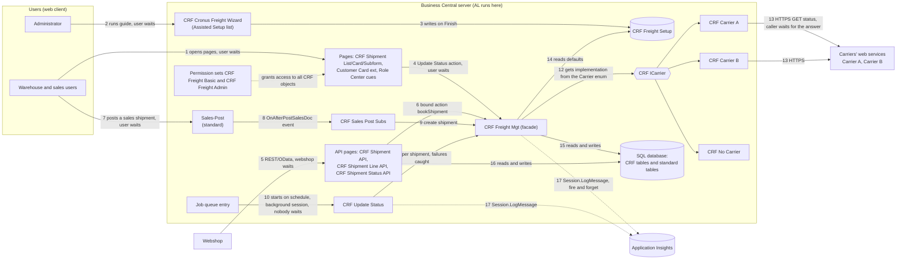

# Part 4: architecture sketch

Business Central has three core parts: the web server that serves the web client, the Business Central server where AL code and scheduled tasks run, and the SQL database. Every Cronus Fragt component is an object in the extension and runs on the server. Everything else is drawn around it.

## Arrows: who starts it and who waits

| # | From to | Started by | Does a user wait? |
|---|---|---|---|
| 1 | Users to pages | The user | Yes. |
| 2-3 | Administrator to guide to setup | The administrator; nothing is saved until Finish | Yes. |
| 4 | Shipment Card action to facade | The user (Update Status) | Yes, and the user also waits for the carrier call behind it. |
| 5-6 | Webshop to API pages, bound action | The webshop | The webshop waits. No carrier call is made from the API in this design (booking changes status only). |
| 7-9 | Posting to subscriber to facade | The user posting a sales shipment | Yes, but only for the creation of a local record. No carrier call happens during posting. |
| 10-11 | Job queue to Update Status to facade | The job queue scheduler, in a background session without user interface | No. A failing carrier is logged, and the next run asks again. |
| 12 | Facade to interface | The facade, from the shipment's Carrier field | Same as the caller. |
| 13 | Carrier codeunit to carrier service | The carrier codeunit behind `CRF ICarrier` (not a page) | The calling session waits until the carrier answers, with a timeout and retries. |
| 14-16 | Facade and API pages to setup and database | The caller | Same as the caller. |
| 17 | Extension to Application Insights | The extension code | No. |

## Where the parts are

| Part | Place on the sketch |
|---|---|
| Setup | `CRF Freight Setup` table, filled by the setup page or by the assisted setup guide |
| Assisted setup | `CRF Cronus Freight Wizard`, registered by `CRF Assisted Setup Subs` |
| Carrier implementations | `CRF Carrier A`, `CRF Carrier B`, `CRF No Carrier` behind `CRF ICarrier`; the enum `CRF Carrier` selects one |
| Facade | `CRF Freight Mgt`: the only public entry point; all callers (pages, API, subscriber, job) go through it |
| API pages | The webshop's door: shipments, lines, read-only status |
| Status polling | A job queue entry running `CRF Update Status` in the background |
| Telemetry | `Session.LogMessage` events `CRF-0001` to `CRF-0004` (see `docs/runbooks/telemetry.md`) to the Application Insights resource named in `applicationInsightsConnectionString` in `app.json` |
| Permissions | Permission sets `CRF Freight Basic` (daily work) and `CRF Freight Admin` (includes Basic; setup and carrier rates); the license decides what a user may do at most, the permission set what they may do |

## Things to remember

- **Outbound HTTP must be allowed.** Calls from the extension are blocked until **Allow HttpClient Requests** is turned on for Cronus Fragt in Extension Management (Configure). Without it the carrier call fails.
- The API key is not in the setup table; it is stored in isolated storage (step 20) and sent as a header.
- A job queue entry must not show dialogs, and it fails only when the whole round fails.
- Telemetry carries no customer data: classify events as `SystemMetadata` and send only counts, carrier and event ids.
